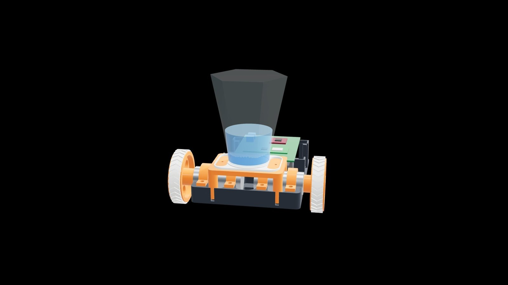
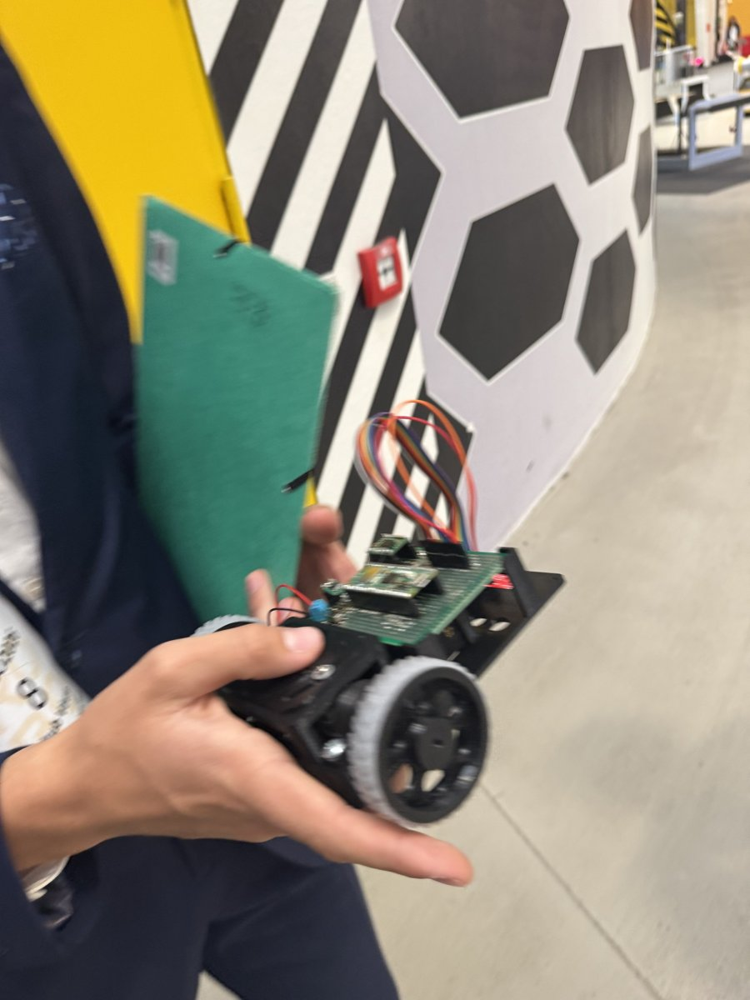
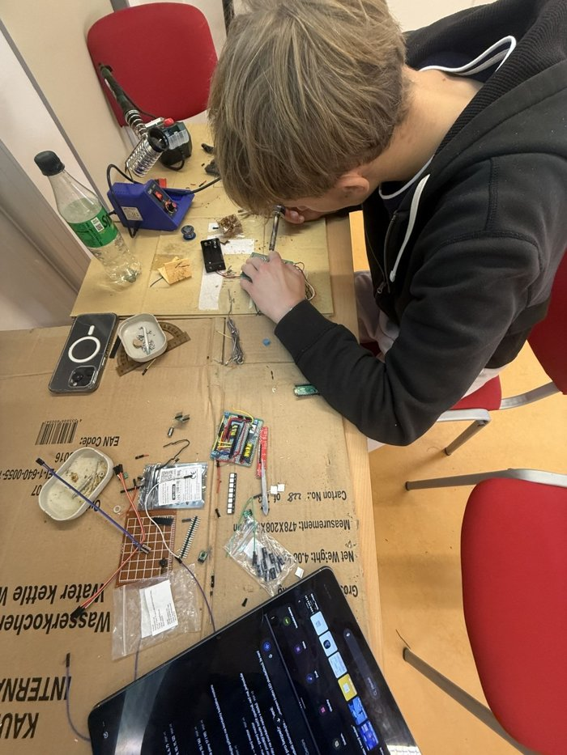
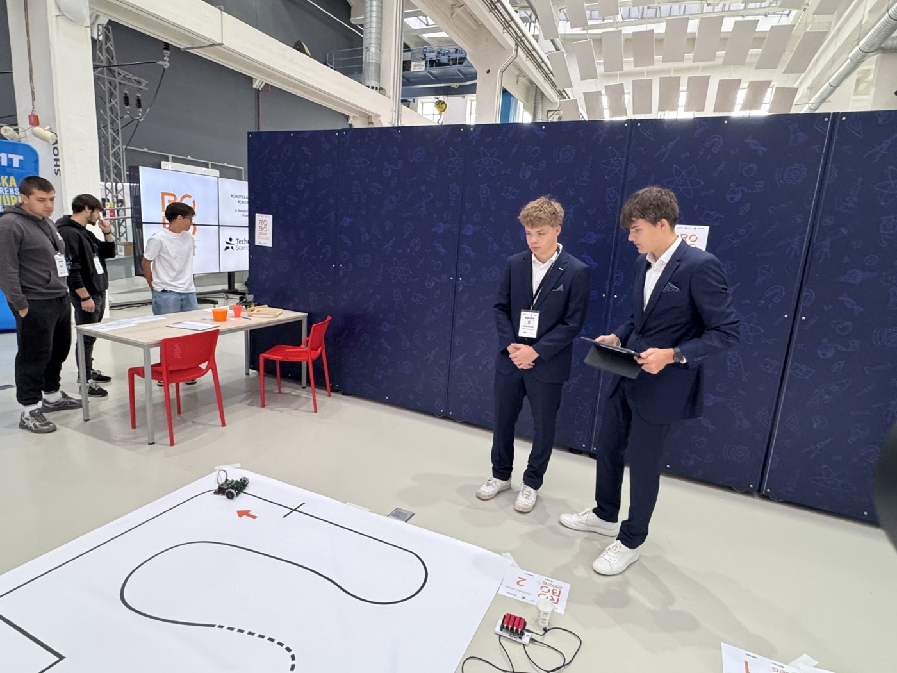
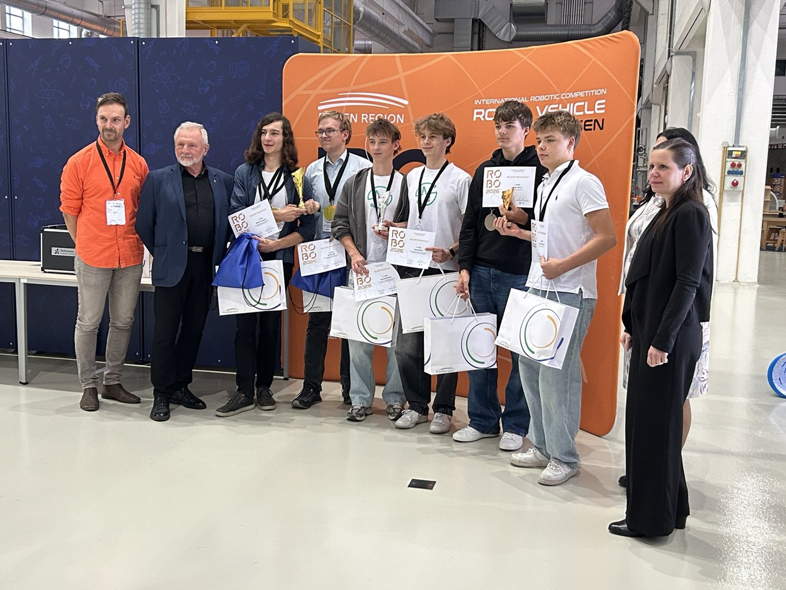

  

<h1 align="center">🤖 ROBO 2026: a line-follower that carries water 💧</h1>

  <b>A small robot car we built from scratch in about two weeks for the ROBO 2026 competition.</b> 
  🥉 3rd place for the presentation · 🎬 <a href="https://youtu.be/i93u59UNURg"><b>Watch the full build story</b></a> · ⚡ <a href="https://youtube.com/shorts/yKaat7GN8Ac">Watch the Short</a> · 🎬 <a href="https://youtube.com/@jakubvavradev">More on YouTube</a>

---

> ℹ️ This repository is a **showcase**: photos, videos and how it works.
> The source code, CAD models and print files are not published.

## 🏁 The challenge

ROBO is a robotics competition for high school teams. The robot has to:

- follow a black line, including **intersections**, **90° corners** and **dashed curves**;
- carry an official cup with **70 ml of water** without spilling;
- fit into a **200 × 200 × 200 mm** cube, cup included;
- finish the track as fast as possible.

## 🛠️ What we built

| | |
|---|---|
| 🧱 **Chassis** | 3D-printed, three versions. v1 plate + stand + cup holder (3 h 31 min print) → v2 one-piece chassis → v3 bigger battery openings (3 h 7 min). |
| 🛞 **Wheels** | Printed rims with tires **cast from silicone in molds we designed and printed ourselves**. |
| 🧠 **Brain** | Raspberry Pi Pico 2 W running MicroPython; the control loop runs **200× per second**. |
| 👀 **Sensors** | An 8-channel IR line sensor and encoders on both wheels. **No camera, no GPS.** |
| 🔋 **Power** | Two 18650 cells; the board was designed on paper and hand-soldered. |
| 📱 **App** | Our own tablet app: live telemetry like in Formula 1, track map, speed plan, saved laps, joystick over Wi-Fi or Bluetooth. |

  
  

## 🗺️ How it races: learn once, then race from a map

1. **Learn**: on the first lap the car drives slowly (200 mm/s) and records the path of both wheels every 10 mm.
2. **Map**: the tablet turns that into a map and finds the intersections, 90° corners, curves and dashed lines.
3. **Plan**: fast on the straights, braking early and smoothly before corners. Every start and stop is an S-curve, so the water stays in the cup.
4. **Race**: the car follows its own map and re-aligns itself at every intersection and corner.

On the competition track the race lap was **44 % faster** than the learning lap (1:46.95 → 1:00.05, real data).

### Four problems we had to solve

- **Intersection or 90° corner?** Both look like "dark across the sensor". The car checks whether its own line continues straight on.
- **Dashed curve**: in the gaps the car drives blind, following the remembered curvature until the line comes back.
- **Water**: no jerky moves. Speed changes follow an S-curve.
- **Losing Wi-Fi while driving**: we fixed the control loop so the app stays connected during a run.

## 🏆 ROBO 2026 (4 November 2026)

The official runs didn't go the way we hoped: a new track, new lighting and a lot to tune in one day.
But we presented the whole story to the judges and **took 3rd place for the presentation**. 🥉

  
  

## 📊 Numbers

| | |
|---|---|
| ⏱️ Race lap vs. learning lap | **−44 %** |
| 🚀 Average race speed vs. our first test | **4.2× faster** |
| 💻 Lines of our own code | **≈ 4,700** |
| 🥉 Presentation | **3rd place** |

## 👋 Follow

Made by **Jakub Vávra** with teammates. I'm **@jakubvavradev** everywhere:
[YouTube](https://youtube.com/@jakubvavradev) · [Instagram](https://instagram.com/jakubvavradev) · [TikTok](https://tiktok.com/@jakubvavradev) · [X](https://x.com/jakubvavradev) · [Threads](https://threads.com/@jakubvavradev) · [GitHub](https://github.com/jakubvavradev)

Also by me: [Agentic TV](https://github.com/jakubvavradev/agentic-tv), a calm home screen for Android TV.

Photos and videos © Jakub Vávra. All rights reserved. Not licensed for reuse.
